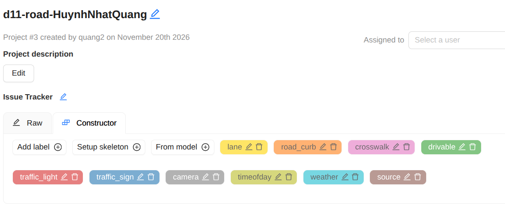
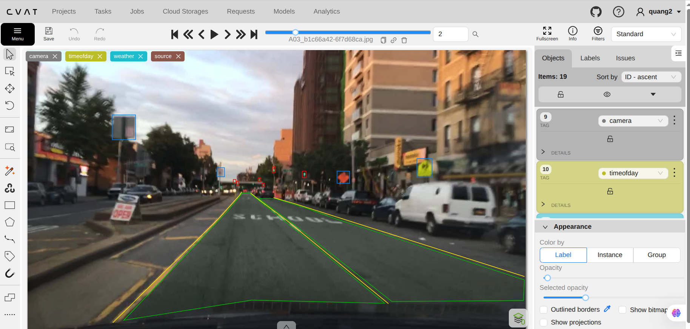
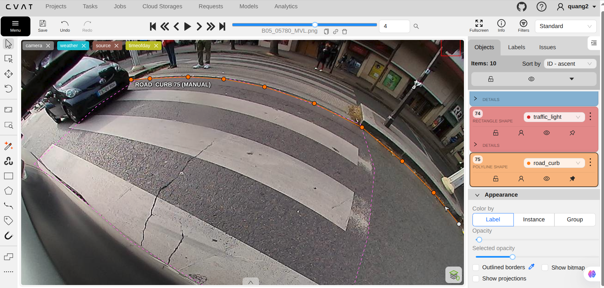
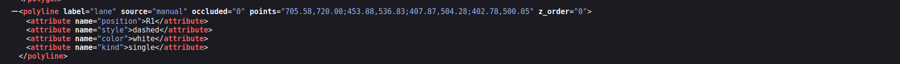

<!-- BẢN NHÁP — đã bỏ mục 4, 6, 8 theo yêu cầu; giữ nguyên số mục của mẫu -->
# Báo cáo cá nhân — Ngày 11
Họ tên: Huỳnh Nhật Quang    Mã học viên: 2A202603113  
Phiên bản CVAT (Help → About): 2.83.1  
Guideline: Road v1.0    Lần nộp (`revision` trong manifest): 1  
Thời điểm export (ngày giờ trên CVAT): front 21/11/2026 01:23, fisheye 21/11/2026 02:01 (giờ Việt Nam)    Số lần nộp lại sau Rework: 0

## 1. Kiểm project
| Mục | Đúng như guideline Road v1.0? | Ghi chú |
| --- | --- | --- |
| 6 label, đúng kiểu | Đúng | lane và road_curb là polyline; crosswalk và drivable là polygon; traffic_light và traffic_sign là rectangle |
| Thuộc tính và giá trị | Đúng | lane: position / style / color / kind; drivable: area_type; đèn: color / type / facing / edge_zone; biển: group / facing / edge_zone |
| 4 tag ảnh | Đúng | camera, timeofday, weather, source; mỗi tag có một thuộc tính select `value` |
Cách kết thúc polyline trên bản CVAT này ||click lần lượt các điểm trên tâm vệt sơn từ gần xe ra xa, rồi bấm phím **N** để kết thúc. | 
Cách đặt tag ảnh trên bản CVAT này |Đúng|mỗi tag là một label kiểu Tag có một thuộc tính select `value` (ví dụ `camera` với `value = fisheye_left`); đặt camera trước tiên, đặt xong kiểm lại giá trị vì CVAT tự điền giá trị đầu danh sách.|

## 2. Số lượng đã gán
| Task | Ảnh | lane | road_curb | crosswalk | drivable | traffic_light | traffic_sign |
| --- | ---: | ---: | ---: | ---: | ---: | ---: | ---: |
| front | 12 | 36 | 7 | 6 | 23 | 39 | 50 |
| front-extra (đã làm 4 / 4) | 4 | 14 | 1 | 3 | 9 | 14 | 20 |
| fisheye | 8 | 14 | 9 | 7 | 1 | 11 | 12 |
| fisheye-extra (đã làm 4 / 4) | 4 | 3 | 4 | 4 | 2 | 0 | 0 |

## 3. Bảng ca khó
| Ảnh | Nhãn | Phân vân giữa | Đã chọn | Lý do |
| --- | --- | --- | --- | --- |
| A04 | drivable (làn đi chuyển sang bên phải) | Gán cả vùng đường là `direct`, hoặc tách vùng bên phải vạch R1 thành `alternative` | Hai polygon: `direct` là làn đang đi, `alternative` là làn bên phải vạch đứt R1 | Guideline: `direct` là làn đang đi, `alternative` là làn cùng chiều bên cạnh; vạch R1 đứt cho phép chuyển làn nên vùng bên phải gán `alternative` |
| A06 | crosswalk / drivable (cờ `occluded`) | Bật `occluded` hoặc để tắt khi xe đỗ và cột cầu che một phần | Bật `occluded` cho polygon crosswalk và drivable bị che | Vẫn vẽ liền theo nguyên tắc "đi được nếu đường trống" thay vì khoét lỗ quanh vật che, và đánh dấu phần bị che bằng cờ |
| A12 | lane (vạch ngoài cùng ở bên trái) | `L2` hoặc `other` | `other` (solid / white / single) | Vạch này không chia ra được thành một lane đường mới mà chỉ đủ để nhận thấy vạch trắng liền không được lấn sang, nên không phải L1, R1, L2, R2 |
| A10 | traffic_sign (biển nhỏ, mờ ở xa) | Bỏ qua vì mờ và cao dưới 8 px, hoặc vẫn gán box | Vẫn gán box; không chắc nhóm thì chọn nhóm gần nhất theo chức năng (`information`) | Biển cao khoảng 7–8 px, không đọc được chữ. Guideline cho chọn nhóm gần nhất khi không chắc, ghi lại ở bảng ca khó; lint chỉ báo mức nhẹ vì biển dưới 8 px không bắt buộc |

## 4. Phiếu QC 1 nhận được
Bạn kiểm lô của tôi:  Quyết định nhận được:  
| Mã lỗi | Số lỗi | Đồng ý? | Đã sửa? |
| --- | ---: | --- | --- |

## 5. Kiểm file export
| File | Mở lại được? | Số shape ảnh 1 (job / file) | Số shape ảnh 2 (job / file) | Tag camera có trong XML? |
| --- | --- | --- | --- | --- |
| huynhnhatquang-front.zip | Có (`lint` đọc được 12 ảnh, 12/12 ảnh đủ 4 tag, không kèm ảnh) | A01: 10 / 10 | A02: 7 / 7 | Có, `camera = front` ở cả 12 ảnh |
| huynhnhatquang-fisheye.zip | Có (`lint` đọc được 8 ảnh, 8/8 ảnh đủ 4 tag, không kèm ảnh) | B01: 4 / 4 | B02: 9 / 9 | Có, `fisheye_front` (B01, B02), `fisheye_rear` (B03, B04), `fisheye_left` (B05, B06), `fisheye_right` (B07, B08) |

## 6. Ảnh chụp màn hình
1. Tab Labels của project `d11-road-HuynhNhatQuang` (6 label và 4 tag):

   

2. Một ảnh camera trước đã gán đủ (A03: làn, vùng lái, đèn, biển và 4 tag ảnh):

   

3. Một ảnh fisheye đã gán, phóng to đoạn polyline cong (B05, `road_curb` đặt điểm theo cung):

   

4. Một đoạn XML có `<polyline label="lane">` (lane R1, dashed, white, single):

   
   
## 7. Tự đánh giá
Lỗi bạn mắc nhiều nhất hôm nay (theo mã QC1-xx), và cách tránh ở Ngày 20:  
Hay phân vân và nhầm lẫn dẫn đến lúc gán thừa hoặc gán thiếu nhãn road_curb.
Cách tránh ở ngày 20 là đọc rõ thông tin trong guideline, nếu không rõ nữa thì hỏi xác nhận lại coach hoặc người viết.

Nhãn của bạn đi vào model ở đâu? Chọn một lỗi đã sửa và nói nó làm model học sai thế nào:  
Nhãn lane đi vào model nhận diện làn (lane detection, hỗ trợ giữ làn LKA). Nếu A01 vẫn gán L1 là `solid` trong khi thực tế là vạch đứt, model sẽ học rằng loại vạch này là vạch liền không được cắt qua, nên khả năng nhận biết vạch đứt (được phép chuyển làn) bị giảm và có thể đưa ra kết luận sai về việc được hay không được chuyển làn.

## 8. (Tùy chọn, buffer) Từ polyline đến đích row-anchor
| y | 720 | 680 | 640 | 600 | 560 |
| --- | ---: | ---: | ---: | ---: | ---: |
| x của chúng tôi |  |  |  |  |  |
| x của bạn kia |  |  |  |  |  |

Trả lời 3 câu:

1. Năm số x đó chính là đích mà một model row-anchor học cho vạch này. Nếu bạn dừng polyline sớm 40 px, hàng nào đổi thành "không có làn"?
2. So với bạn được kiểm (cùng ảnh): ở hàng 720 và hàng 560, hai bạn lệch nhau bao nhiêu pixel? Lệch ở hàng nào ảnh hưởng LKA nhiều hơn (slide 25)?
3. Nếu polyline vẽ từ xa về gần (ngược quy tắc 2), cách tính trên có đổi không? Script nào sẽ gặp khó?